# Bank Customer Churn Prediction

**Which bank customers are about to leave, and what can the bank do to keep them?**

An end-to-end machine-learning project on **10,000 bank customers**, 1 in 5 of whom closed their account. I explored who leaves, then compared and tuned 3 models. I chose the call threshold that maximises **profit**, not accuracy, and built a **two-page Streamlit app**: upload any customer file (CSV, Excel, PDF, Word), then see every at-risk customer by name.

**Headline:** the tuned model reaches **62% of churners by calling only 20% of customers** (3.1× better than random). Targeting with it makes **about 2.9× more profit** than calling everyone.

### ▶ [Try the live app](https://eshan-bank-churn.streamlit.app/)

[](https://eshan-bank-churn.streamlit.app/)
No install needed: open the link, click **Try a messy file** or **Try an Indian bank file**, then **Show me the problems**, or upload your own customer file. (It's on free hosting, so if it has been asleep, click "Yes, get this app back up" and give it about a minute.)

    

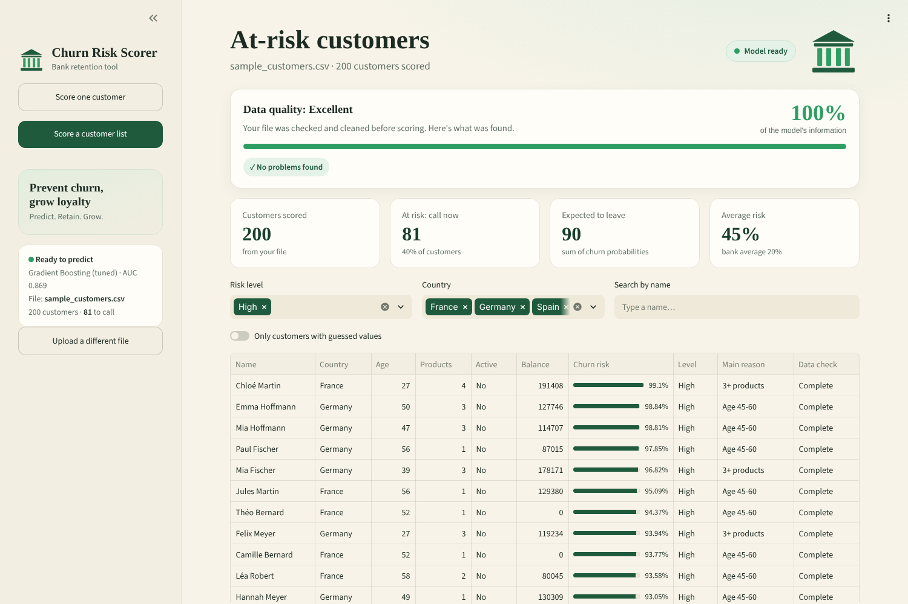

---

## 1. Who leaves?

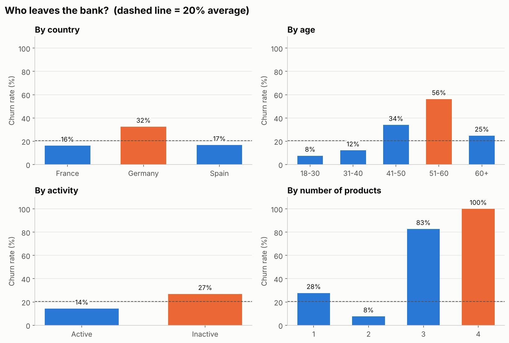

| Finding | Number |
|---|---|
| Overall churn | **20.4%** (2,037 of 10,000 customers) |
| Germany vs France / Spain | **32%** vs 16-17% |
| Age 51-60 vs 18-30 | **56%** vs 8% |
| Inactive vs active members | **27%** vs 14% |
| 2 products vs 1 product | **8%** vs 28% |
| 3-4 products | **83-100%** leave, so these bundles have a problem |
| Deposits held by churners | **24%** of all balances |

## 2. Models: compared, then tuned

Trained on 8,000 customers and tested on 2,000 they had never seen. Tuning used `RandomizedSearchCV` (20 settings × 5-fold CV) on the training data only.

| Model | CV ROC-AUC | Test ROC-AUC |
|---|---|---|
| Logistic Regression | 0.766 | 0.777 |
| Random Forest | 0.859 | 0.862 |
| Gradient Boosting | 0.854 | 0.852 |
| Random Forest (tuned) | 0.862 | 0.866 |
| **Gradient Boosting (tuned)** ✅ final | **0.865** | **0.869** |

The final model was chosen by **cross-validation** score, not test score, so the test set stays a fair final check. At a 0.5 threshold it catches **77% of churners**, and about half of the customers it flags really do leave.

<p float="left">
  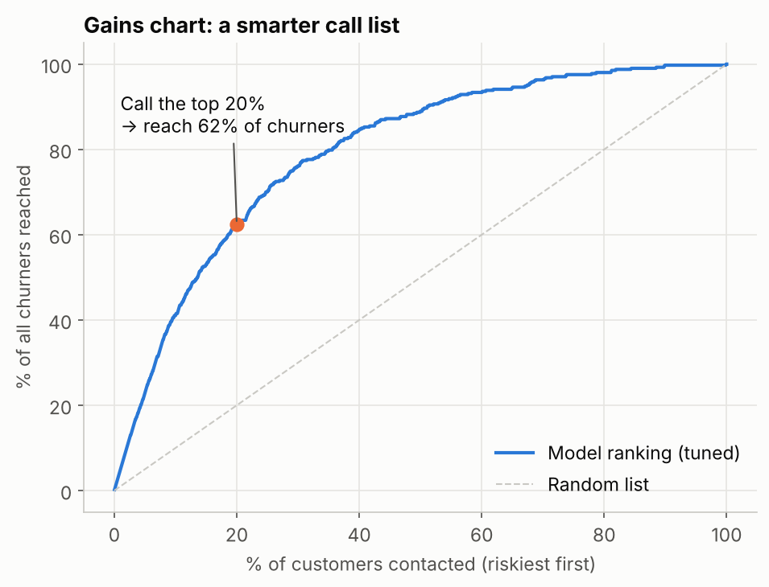
  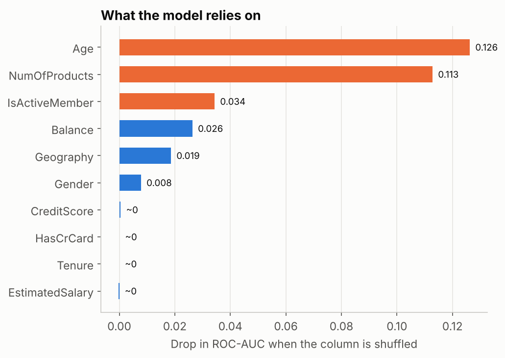
</p>

**What drives churn** (permutation importance): age and number of products matter most, followed by activity, balance and country. Credit score, salary, tenure and owning a card add almost nothing.

## 3. Choosing who to call: a profit-based threshold

A model's default 0.5 cut-off ignores money. I scored every threshold with clear, editable assumptions: **50** per call and offer, **1,000** value per saved customer, and a **30%** save rate.

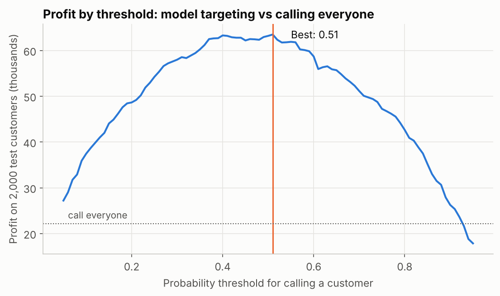

| Scenario (offer cost / customer value / save rate) | Best threshold | Customers called (of 2,000) |
|---|---|---|
| Base case (50 / 1,000 / 30%) | 0.51 | 608 |
| Expensive offer (150 / 1,000 / 30%) | 0.77 | 252 |
| Cheap SMS nudge (5 / 1,000 / 10%) | 0.18 | 1,412 |
| High-value customers (50 / 3,000 / 30%) | 0.18 | 1,412 |

In the base case, model targeting earns **63,500 vs 22,100** for calling everyone. The table shows **the best threshold depends on the bank's costs**, so it's a business decision, not a fixed number.

## 4. The app: Bank Churn Risk Scorer

A two-page Streamlit app that turns the model into a tool a retention team can use.

**Page 1: upload any customer file.** It reads **CSV, Excel (.xlsx/.xls), PDF tables, Word tables, JSON or text**. Columns are matched automatically even when names differ ("Country" → Geography, "No. of products" → NumOfProducts), and you can fix any match by hand. If the file has a name or ID column, every result shows **who** the customer is.

**Messy data is cleaned automatically.** Real exports are rarely tidy, so every value is checked before scoring, and nothing is silently dropped or silently wrong:

| Problem in the file | What the app does |
|---|---|
| Text in number columns: `₹1,20,000`, `50k`, `1.2 lakh`, `45 yrs`, `forty`, `7OO` | Reads the real number (120000, 50000, 120000, 45, 40, 700) |
| Typos and codes: `Germny`, `frnace`, `DE`, `espana`, `F.`, `woman`, `TRUE` | Matched to the right value with a typo-tolerant check |
| Impossible values: age 250, credit score 5000, 0 products | Treated as mistakes and filled with a typical value |
| Fixable mistakes: a birth year in the age column, a negative balance, 7 products | Turned into an age, set to 0, or capped at 4 |
| Blank, `N/A`, `?`, `unknown` | Filled with the typical value in your own file (median or most common) |
| Duplicate rows, repeated customer IDs, empty rows | Removed |
| Title rows above the header, extra sheets, semicolon-separated or non-UTF-8 files | Detected and handled |
| `RAHUL VERMA`, blank names | Tidied, or replaced by the customer ID |

After cleaning, the app shows a **data-quality score** (how much of the model's information the file really provides, weighted by how much the model relies on each column) and a full cleaning report with examples. Every customer whose score rests on a guessed value is flagged in a **Data check** column. Missing columns are handled the same way, and if nothing usable is found, the app explains why instead of scoring. Click **Try a messy file** on the upload page to see it in action.

**See every problem before scoring.** As soon as a file is read, a pop-up and a card say how many rows have missing or wrong values, and in which columns (for example, "67 of 211 rows have missing or wrong values in 10 columns"). **Show me the problems** opens the whole file with each problem cell highlighted:

| Colour | Meaning |
|---|---|
| 🟨 Yellow | Missing or wrong: the model gets a typical value instead, so check these first |
| 🟩 Green | Messy but fixed automatically (`50k` → 50,000, `frnace` → France) |
| 🟥 Red row | Removed: "Exact copy of row 16", "Same customer ID as row 40", or nothing usable |

Every row gets a plain-English **What's wrong** note. You can filter by problem type or by column, page through files of any size (500 rows at a time, so a million-row file opens in about a second), and download every problem row as a CSV to fix the data at its source.

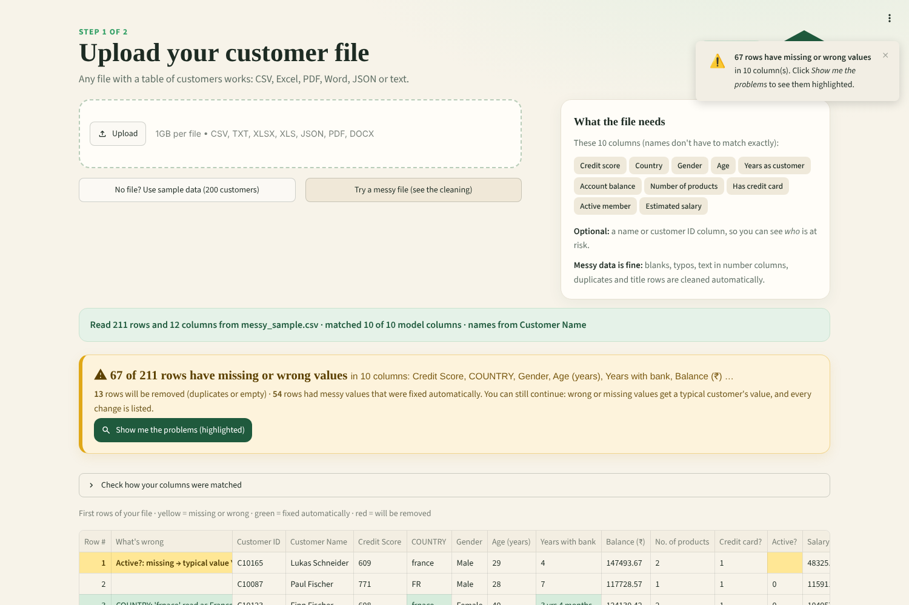

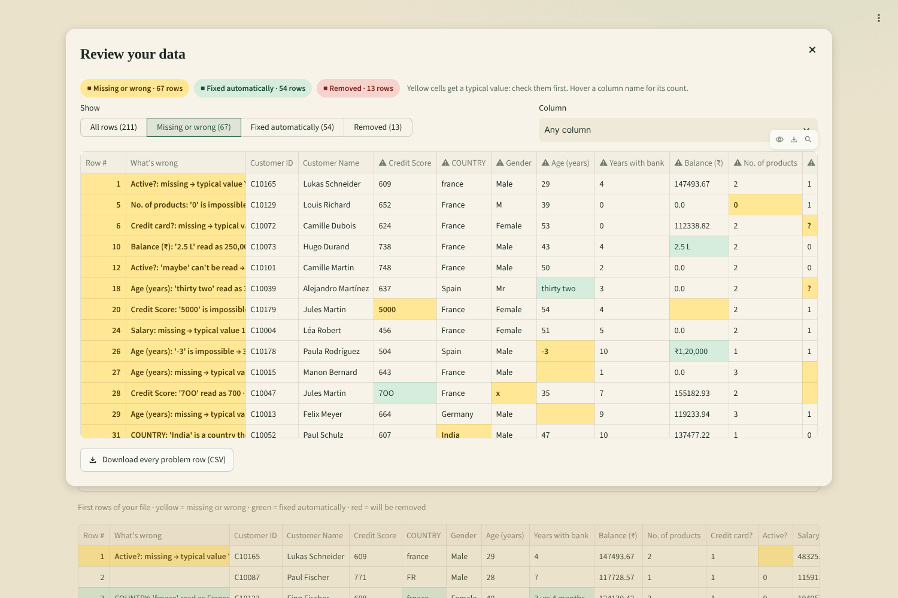

After scoring, the results page shows the data-quality score and the full cleaning report:

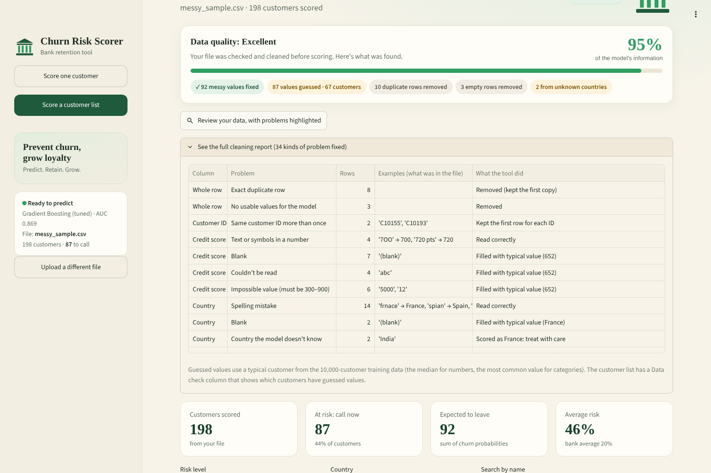

### Works with any customer file you're handed

An interviewer, or a real bank, won't use my column names, my currency or my country. So the app adapts instead of failing:

| What's different | What the app does |
|---|---|
| **Unfamiliar column names**: `CIBIL_Score`, `Account_Balance (INR)`, `Num_Products`, `Active_Status`, `Months_on_book`, `CLIENTNUM` | Matched by the words in the name, with traps avoided (`Months_Inactive_12_mon` isn't an "active" flag, `Credit_Limit` isn't "has a credit card"). Every match can be changed by hand. |
| **Indian formats**: `₹9,17,700`, `1.2 Cr`, `6.5 LPA`, `6-8 LPA`, `NIL`, CIBIL 300–900 | Read correctly (a range uses its midpoint) |
| **Rupees or dollars** | Detected from symbols, column names and places. Converted to euros (the model's currency) only for scoring, at early-November-2026 rates. You still see your own currency everywhere. |
| **Dates and units**: date of birth `12/05/1990`, joining year `2016`, tenure in months | Turned into age and years as a customer (day-first dates, as written in India) |
| **Places and categories the model never saw**: Indian states, gender "Other" | Shown in blue (not counted as errors), scored with the nearest value the model knows, plus a clear note that a new market needs retraining |
| **A column with the real outcome**: `Exited`, `Churn`, `Attrition_Flag`, `Account Closed` | **Accuracy check**: AUC, leavers caught, how many flagged customers really left, and how many leavers the riskiest 20% reached |
| **Broken files**: damaged Excel, empty files, nothing matching | A plain-English reason instead of a crash. Tested on about 1,000 randomly broken files. |

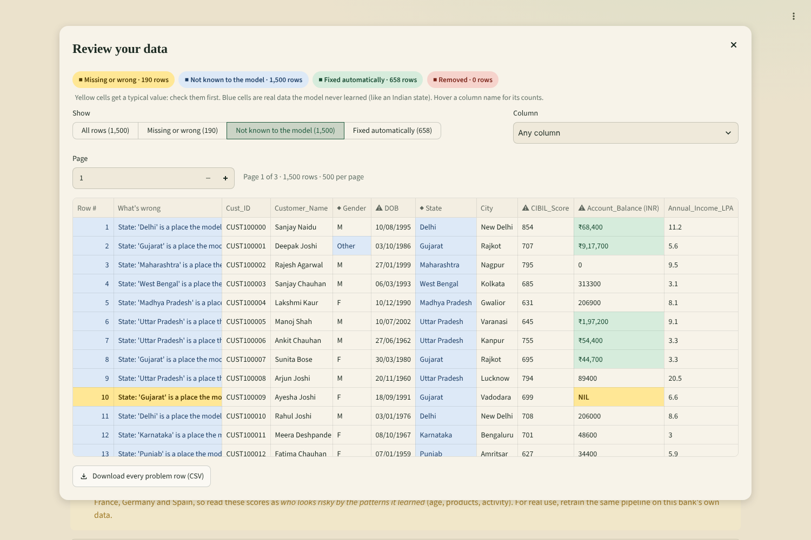

**Accuracy check on real data I didn't train on:** on IBM's public telecom churn dataset, only 2 of the 10 inputs exist (gender and tenure), so the app reports "Very limited (3%)" and an honest AUC of 0.58. On the original bank file it shows AUC 0.88 and warns that this is optimistic, because the model was trained on that file:

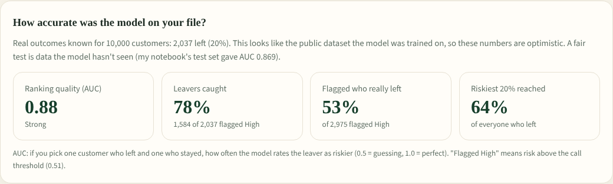

The **Indian bank file** demo is 1,500 made-up customers in Indian formats. No real Indian customer data is public: banks can't share it under the DPDP Act 2023. For an Indian bank, the right step is to retrain this same pipeline on that bank's own data.

**Built for big files:** tested with **1,000,000 customers**. A clean 74 MB file takes about 4 seconds to read and about 15 seconds to clean and score. A messy one, with 440,000 values to fix, takes about 7 seconds to read and about 20 seconds to clean and score. Cleaning works once per distinct value, not once per row, which keeps it fast. Tables show the riskiest 1,000, and the download contains every customer. (The free online version scores up to 300,000 rows at a time because of its memory limit. On your own computer there's no limit.)

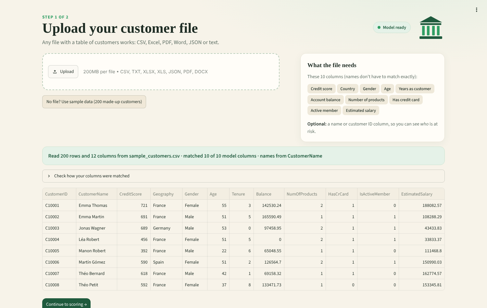

**Page 2: score.**
- **Score a customer list:** every customer is ranked by churn risk *by name*. You get KPI cards (at-risk count, expected leavers), filters by risk level, country and name, the main reason for each customer, charts, and a downloadable call list.
- **Score one customer:** pick anyone from the file, or type details in by hand. You see a risk gauge, the risk level, the comparison with the bank average, the reasons, suggested actions, and a **what-if panel** showing how much the risk would drop if the customer became active or moved to 2 products.


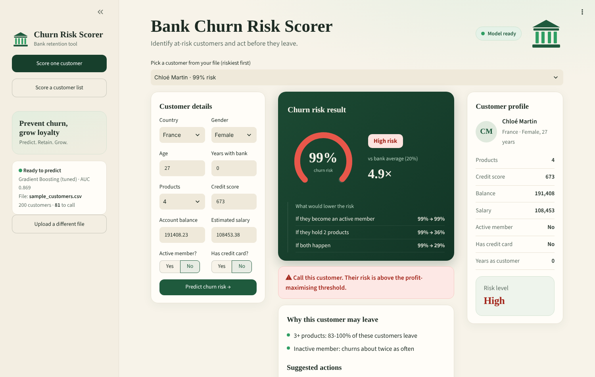

## Recommendations

1. **Score every customer monthly** and call everyone above the profit-maximising threshold. Even just the riskiest 20% covers 6 in 10 future churners.
2. **Fix the 3-4 product bundles.** Almost everyone who holds them leaves.
3. **Move single-product customers to 2 products.** Churn drops from 28% to 8%.
4. **Re-engage inactive members.** They churn twice as much.
5. **Give customers aged 45-60 a relationship manager.** About half of them leave.
6. **Investigate Germany**, where churn is double the other countries.

## Run it yourself

The quickest way is the [live app](https://eshan-bank-churn.streamlit.app/). To run it on your own computer:

```bash
git clone https://github.com/Eshan-vijayvargiya/bank-churn-prediction.git
cd bank-churn-prediction
pip install -r requirements.txt

python -m streamlit run app/app.py                    # the app (uses the saved model)
jupyter notebook notebooks/churn_prediction.ipynb     # the full analysis
```

The app runs straight away. Upload your own file, or try a demo: **Use sample data** (200 made-up customers), **Try a messy file** (the cleaning), or **Try an Indian bank file** (₹, CIBIL, states, dates of birth). To re-run the notebook, first put `Churn_Modelling.csv` in `data/` (see [data/README.md](data/README.md)).

## Project structure

```
bank-churn-prediction/
├── notebooks/churn_prediction.ipynb   # analysis: EDA, models, tuning, profit threshold
├── app/app.py                         # Streamlit app: upload page + scoring pages
├── app/loader.py                      # reads CSV/Excel/PDF/Word/JSON, finds the header, matches columns
├── app/cleaner.py                     # cleans messy values and writes the cleaning report
├── app/review.py                      # review screen: the file with every problem cell highlighted
├── app/scoring.py                     # risk, reasons, suggested actions, what-if
├── app/ui.py                          # page design (styles and cards)
├── app/sample_customers.csv           # 200 made-up customers to try the app
├── app/messy_sample.csv               # the same customers made deliberately messy, to show the cleaning
├── app/indian_sample.csv              # 1,500 made-up customers in Indian formats (₹, LPA, CIBIL, states)
├── .streamlit/config.toml             # app theme
├── models/churn_model.joblib          # tuned model (pre-processing + Gradient Boosting)
├── models/model_info.json             # threshold and scores used by the app
├── images/                            # charts and app screenshots
├── data/README.md                     # where to get the dataset
├── INTERVIEW_NOTES.md                 # how I explain this project
└── requirements.txt
```

---

Built by **Eshan Vijayvargiya**: [LinkedIn](https://www.linkedin.com/in/eshan-vijayvargiya-724584404/) · [GitHub](https://github.com/Eshan-vijayvargiya)
